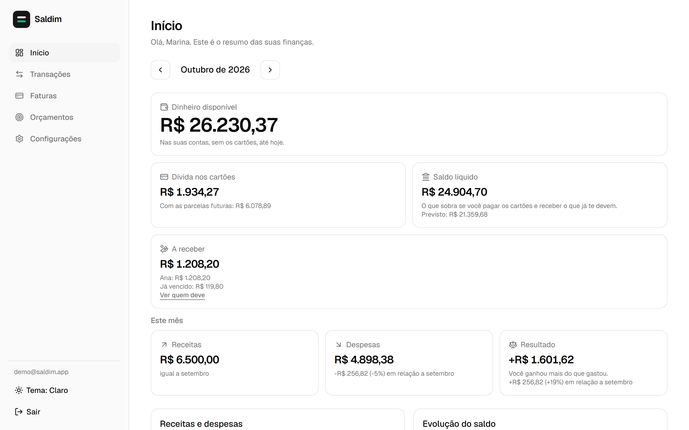
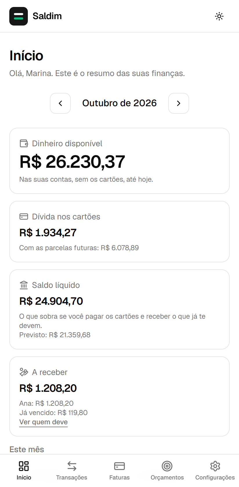
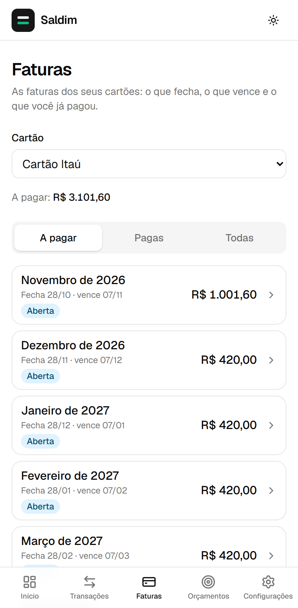
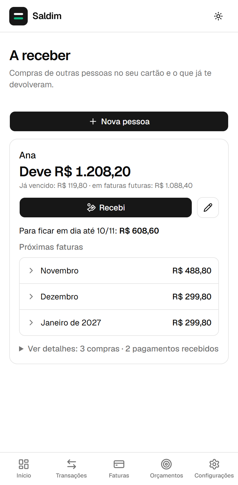
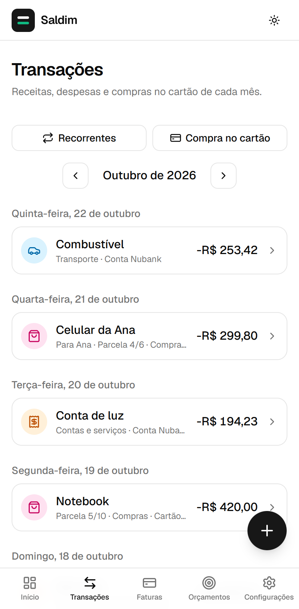

# Saldim

**Finanças pessoais com o número certo.** Um app web para registrar receitas e despesas, controlar
cartões de crédito do jeito que eles funcionam de verdade (faturas, parcelas, estornos) e saber quanto
cada pessoa te deve pelas compras que fez no seu cartão.

🔗 **Demo:** [saldo-orpin.vercel.app](https://saldo-orpin.vercel.app)

<p align="center">
  <picture><source media="(prefers-color-scheme: dark)" srcset="docs/screenshots/inicio-desktop-escuro.png"></picture>
</p>

<p align="center">
  <picture><source media="(prefers-color-scheme: dark)" srcset="docs/screenshots/inicio-celular-escuro.png"></picture>
  <picture><source media="(prefers-color-scheme: dark)" srcset="docs/screenshots/faturas-celular-escuro.png"></picture>
  <picture><source media="(prefers-color-scheme: dark)" srcset="docs/screenshots/a-receber-celular-escuro.png"></picture>
  <picture><source media="(prefers-color-scheme: dark)" srcset="docs/screenshots/transacoes-celular-escuro.png"></picture>
</p>

<sub>Capturas feitas com uma conta de demonstração e dados inventados (<code>npm run demo:seed</code> e
<code>npm run demo:screenshots</code>).</sub>

## Por que mais um app de finanças

A maioria dos apps trata o cartão de crédito como uma conta comum, e aí o saldo nunca bate com o banco.
O Saldim foi feito a partir de um princípio: **o número que aparece na tela tem que bater com o banco e
com a fatura.**

## O que ele faz

- **Início:** dinheiro disponível, dívida nos cartões, saldo líquido e saldo previsto; resumo do mês
  comparado com o anterior, gastos por categoria e gráficos de 6 meses.
- **Cartões de crédito:** cada compra cai na fatura certa conforme os dias de fechamento e vencimento;
  compras parceladas (inclusive as que já estavam em curso), estornos, pagamento total ou parcial da
  fatura e limite disponível. Se os dias do cartão mudarem, as faturas antigas continuam certas.
- **Compras de outras pessoas:** marque que uma compra no seu cartão é da sua mãe ou de um amigo. Ela
  sai dos seus gastos, entra em **A receber** e o app mostra quanto já venceu, quanto vem nas próximas
  faturas e os pagamentos que a pessoa já fez.
- **Lançamentos recorrentes:** salário, aluguel e assinaturas são lançados sozinhos quando chega o dia.
- **Orçamentos mensais** por categoria, com aviso ao chegar perto do limite.
- **Celular primeiro:** feito para registrar um gasto em segundos, logo depois de pagar. Tema claro e
  escuro.

## Destaques técnicos

- **Dinheiro sempre em centavos inteiros** (`bigint` no Postgres), nunca em ponto flutuante.
- **Segurança no banco de dados:** Row Level Security em todas as tabelas, chaves estrangeiras compostas
  `(id, user_id)` que impedem usar dados de outro usuário mesmo sabendo o id, e um teste que falha se
  alguma tabela nova ficar sem proteção.
- **Regras garantidas pelo banco, não só pela tela:** compras parceladas e estornos passam por funções
  SQL atômicas, e triggers barram qualquer escrita que quebre as regras. O cálculo das faturas em SQL é
  comparado com o do TypeScript em todas as configurações possíveis de cartão.
- **Cálculos financeiros em funções puras** (`src/lib/finance.ts`, `src/lib/credit-card.ts`), testadas
  sem React.
- **Três níveis de testes:**
  - mais de 400 testes unitários e de componentes (Vitest + Testing Library);
  - quase 200 testes de integração contra o Supabase local, incluindo isolamento entre dois usuários;
  - testes ponta a ponta com Playwright, no desktop e no celular.
- **Acessibilidade:** gráficos com tabela alternativa e estados comunicados por cor, ícone e texto,
  nunca só por cor.

## Tecnologias

React 19 · TypeScript · Vite · Tailwind CSS 4 · shadcn/ui · TanStack Query · React Hook Form + Zod ·
Recharts · Supabase (Postgres, Auth, RLS) · Vitest · Playwright

## Como rodar localmente

Requisitos: Node 22 e Docker Desktop (para o Supabase local).

```bash
npm install
npm run db:start    # sobe o Supabase local no Docker
npm run env:local   # gera o .env com a URL e a chave pública locais
npm run dev         # http://localhost:5173
```

## Comandos

| Comando                    | O que faz                                                         |
| -------------------------- | ----------------------------------------------------------------- |
| `npm run dev`              | Servidor de desenvolvimento                                       |
| `npm run build`            | Verifica os tipos e gera a build                                  |
| `npm run lint`             | Analisa o código (oxlint)                                         |
| `npm test`                 | Testes unitários e de componentes                                 |
| `npm run test:rls`         | Testes de integração e segurança contra o Supabase local          |
| `npm run test:e2e`         | Testes ponta a ponta (Playwright)                                 |
| `npm run demo:seed`        | Cria a conta de demonstração no Supabase local (dados inventados) |
| `npm run demo:screenshots` | Tira as capturas do README com a conta de demonstração            |
| `npm run verify`           | Tudo acima, mais a formatação; para na primeira falha             |

## Estrutura

```
src/
  features/      # uma pasta por área: transações, cartões, faturas, a receber, orçamentos…
  lib/           # regras de dinheiro, datas e cálculos financeiros (funções puras)
  components/    # layout, formulários e componentes de interface
supabase/
  migrations/    # tabelas, RLS, triggers e funções, versionadas
tests/rls/       # testes de integração e isolamento entre usuários
e2e/             # testes ponta a ponta
docs/plano.md    # regras financeiras e decisões de projeto
```

## Autor

Feito por **Eduardo Ribeiro** ([@Eduarddoribeiro](https://github.com/Eduarddoribeiro)), com o Claude Code
como par de programação.
